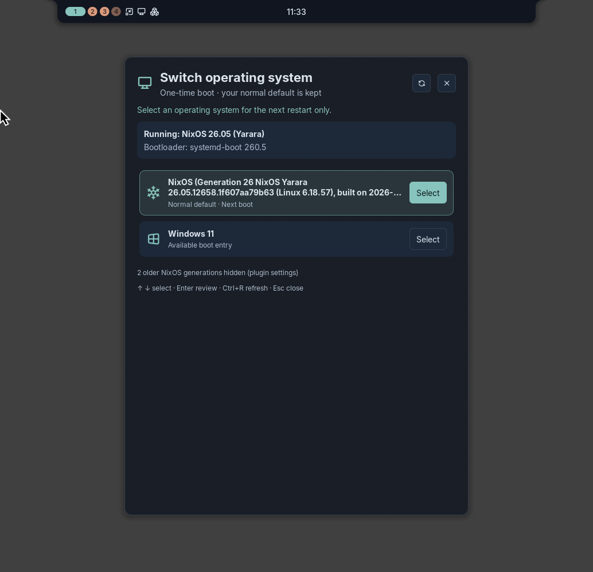
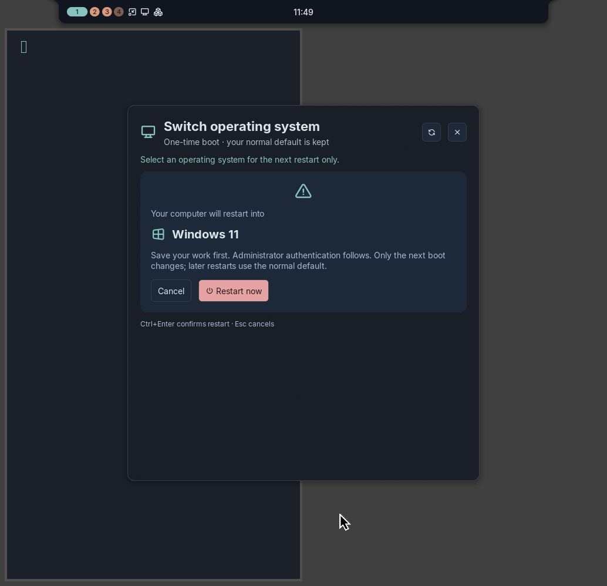

# Noctalia Boot

The interface is branded **Noctalia Boot**. Existing command names, plugin IDs, NixOS options and data paths remain unchanged for compatibility.

Choose which operating system starts on the **next boot only**, from a native
[Noctalia Shell](https://noctalia.dev) v5 panel, with an explicit confirmation and administrator
authentication through PolicyKit. Built for dual-boot machines (for example NixOS + Windows 11)
that use **systemd-boot**.

| Choose | Confirm |
|---|---|
|  |  |

*Screenshots from the earlier branding: the real panel in Noctalia 5.0.1, showing a real systemd-boot menu that was captured
read-only and replayed by a test fixture (no restart was requested).*

## What it does

1. `Super+Shift+P` (or the bar button / control-center tile) opens the switcher.
2. It lists the entries of the real systemd-boot menu (`bootctl --json=short list`), marking the
   **normal default**, the entry that will start **next**, and the one **running now**.
3. Selecting an entry changes nothing. A confirmation card shows exactly which system the computer
   will restart into.
4. **Restart now** (or `Ctrl+Enter`; plain `Enter` never confirms) asks for administrator
   authentication. Then a small root helper:
   - re-detects the bootloader and re-reads a fresh boot catalog;
   - accepts only an exact, local entry id from that catalog (no patterns, selectors, firmware
     or remote entries; titles are never executed);
   - runs `bootctl set-oneshot <id>` and verifies `LoaderEntryOneShot`;
   - requests `systemctl --check-inhibitors=yes reboot` (shutdown inhibitors are respected);
   - if anything fails, restores the previous one-time entry and reports the error.
5. systemd-boot consumes the one-time entry. Every later boot uses your unchanged default.

It **never** calls `bootctl set-default`, never edits `loader.conf`, boot entries or the EFI system
partition, and never restarts without confirmation. Any entry can be chosen, so it also works for
booting a specific NixOS generation once.

## Supported platforms

| Boot setup | Behaviour |
|---|---|
| UEFI + **systemd-boot** | Full support (detected through the Boot Loader Interface EFI variables) |
| **GRUB** | Detected; switching is refused with an explanation. `grub-reboot` requires `GRUB_DEFAULT=saved` and a writable, validated environment block; that cannot be verified safely, so no command is run |
| Other EFI boot managers (rEFInd, …) | Reported by name; switching refused |
| Legacy BIOS | Reported; switching refused |

Windows is listed when systemd-boot has an entry for it: either an automatically detected
`auto-windows` entry or a manual one. On NixOS a manual entry looks like this (adjust the path if
your Windows boot manager is elsewhere on the ESP):

```nix
boot.loader.systemd-boot.extraEntries."windows11.conf" = ''
  title Windows 11
  efi /EFI/Microsoft/Boot/bootmgfw.efi
'';
```

If no Windows entry exists, the panel says so; this project does not create boot entries.

## Requirements

- Noctalia **v5**, plugin API 24+ (tested on **5.0.1**).
- systemd (`bootctl`, `systemctl`) and PolicyKit with a running authentication agent (Noctalia's
  `polkit_agent = true`, polkit-gnome, …).
- An **active local session** (PolicyKit rules below).
- Python 3 standard library (supplied by the Nix package).
- Works with any compositor; the optional key binding file is for Niri.

## Installation (NixOS)

The privileged helper must be registered with PolicyKit system-wide, so the supported installation
is the NixOS module.

### Flakes

```nix
{
  inputs.noctalia-switch-os.url = "github:SwashX-dev/Noctalia-Boot";
  inputs.noctalia-switch-os.inputs.nixpkgs.follows = "nixpkgs";

  outputs = { nixpkgs, noctalia-switch-os, ... }: {
    nixosConfigurations.myhost = nixpkgs.lib.nixosSystem {
      system = "x86_64-linux";
      modules = [
        ./configuration.nix
        noctalia-switch-os.nixosModules.default
        { programs.noctalia-switch-os.enable = true; }
      ];
    };
  };
}
```

### Channels

```nix
# configuration.nix — keep the checkout somewhere only root can write, e.g. /etc/nixos/vendor
{
  imports = [ ./vendor/noctalia-switch-os/nix/module.nix ];
  programs.noctalia-switch-os.enable = true;
}
```

```bash
sudo nixos-rebuild build && sudo nixos-rebuild switch
```

### What the module changes

- adds the package to `environment.systemPackages` and links `share/noctalia-switch-os`;
- enables `security.polkit` (already on for most desktops);
- installs two PolicyKit actions bound to fixed Nix-store executables:

| Action | Executable | Active session | Inactive | Other |
|---|---|---|---|---|
| `noctalia.switchos.list` | `noctalia-switch-os-list` (read-only catalog) | allowed | admin auth | denied |
| `noctalia.switchos.reboot` | `noctalia-switch-os-reboot` (one-time entry + restart) | **admin auth** | denied | denied |

- writes `/etc/noctalia-switch-os/niri-binds.kdl` (key binding, unused until you include it).

It does not change any bootloader option. A warning is printed if `boot.loader.systemd-boot.enable`
is false.

## Enabling the plugin and shortcut

```bash
noctalia-switch-os-setup check     # shows conflicts with existing Niri bindings
noctalia-switch-os-setup apply     # backup, conflict check, `niri validate`, include, enable plugin
```

`apply` adds `include optional=true "/etc/noctalia-switch-os/niri-binds.kdl"` to your Niri
config and registers/enables the plugin `local/switch-os` through Noctalia's IPC. It refuses to
overwrite an existing `Super+Shift+P` binding; use `--replace-desk-tools` to replace the binding of
the original Desk Tools plugin, `--replace Mod+Shift+P` to comment out another one, or pick a
different key with `programs.noctalia-switch-os.keybinding`.

The binding runs:

```kdl
Mod+Shift+P hotkey-overlay-title="Noctalia Boot" { spawn "noctalia" "msg" "panel-toggle" "local/switch-os:switcher"; }
```

Bar button: add a widget of type `local/switch-os:boot-button` to a bar.

## Configuration

| NixOS option | Default | |
|---|---|---|
| `programs.noctalia-switch-os.enable` | `false` | |
| `programs.noctalia-switch-os.package` | this repository | |
| `programs.noctalia-switch-os.keybinding` | `"Mod+Shift+P"` | |
| `programs.noctalia-switch-os.installNiriBindings` | `true` | |

| Plugin setting | Default | |
|---|---|---|
| `enabled` | `true` | |
| `show_all_generations` | `false` | By default only the default/current/next and newest NixOS entries are listed |

## Usage from a terminal

```bash
noctalia-switch-os status                                   # JSON catalog (read-only action)
noctalia-switch-os start --entry windows11.conf --confirmed # same path as the panel's Restart now
```

`start` without `--confirmed` is refused.

## Troubleshooting

- **"You are not authorized … from this session"** — PolicyKit only allows this from an active
  local session (not SSH or a background service). Log in locally.
- **"Authentication was cancelled or failed"** — nothing was changed.
- **A shutdown inhibitor blocks restart** — the previous one-time entry is restored; close the
  blocking application (`systemd-inhibit --list`) and try again. Inhibitors are never overridden.
- **The selected entry no longer exists** — the menu changed (for example after a rebuild);
  refresh with `Ctrl+R`.
- **Windows asks for a BitLocker recovery key** — that is a Windows/firmware matter; the plugin
  only selects the entry.
- Logs: `journalctl -t noctalia-switch-os`, `bootctl status`, `~/.cache/noctalia/noctalia.log`.

## Updating

Update the flake input (`nix flake update noctalia-switch-os`) or your checkout, then rebuild.

## Uninstalling and rollback

1. `noctalia-switch-os-setup undo` (restores the backed-up Niri config, disables the plugin) or
   `noctalia-switch-os-setup remove` (removes only the managed include line).
2. Remove the module and rebuild; this removes the helper and both PolicyKit actions. Do not
   remove PolicyKit itself if other software uses it.
3. To clear a one-time selection made by mistake before restarting: `sudo bootctl set-oneshot ""`.
4. `sudo nixos-rebuild switch --rollback` returns to the previous system generation at any time.

## Known limitations

- systemd-boot only; GRUB and others are detected and refused (see above).
- A restart is required; running systems cannot be switched live.
- The menu shows what systemd-boot lists. Entries hidden by `auto-entries no` (as on the
  development machine) must be declared explicitly, e.g. the Windows example above.

## Development and tests

```bash
nix flake check -L
nix build .#default -L
PYTHONPATH=backend python3 -m unittest discover -s tests -v
```

| Test | Kind |
|---|---|
| `tests/test_boot.py`: bootloader detection (systemd-boot, GRUB, BIOS, other), catalog parsing, default/next/current marking, missing Windows, exact command construction, invalid/stale ids, selection/verification/restart failures and rollback of the one-time entry | **Mocked** runners; never touches EFI variables |
| `tests/test_cli.py`: confirmation gate, pkexec argv, cancelled (126) and unauthorized (127) authentication, interrupted operations | Mocked |
| `checks.plugin` | Real Luau compile, Noctalia linter, PolicyKit XML validation |
| `checks.vm` | **Real systemd-boot in a UEFI NixOS VM**: PolicyKit actions registered; catalog lists NixOS, a specialisation and a Windows entry; an unauthorized user is refused; invalid ids change nothing; the root helper sets a one-time entry for the specialisation and reboots; the VM comes back in that entry with the default unchanged; the next restart returns to the default |

Not tested automatically: an actual Windows boot, and the graphical PolicyKit prompt (the VM test
runs the helper as root). On the development workstation the switcher UI was exercised in Noctalia
5.0.1 with the machine's real boot catalog; restarting the workstation itself was deliberately not
part of testing.

## License

MIT — see [LICENSE](LICENSE).
